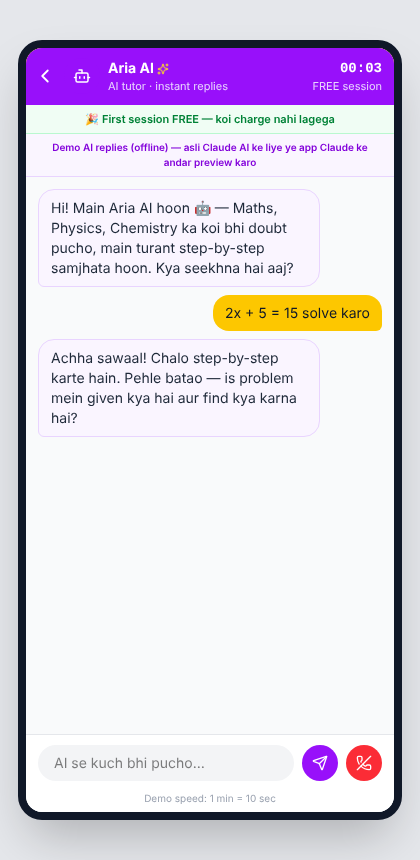

# EduTalk — Learn on demand 🎓

An edtech marketplace app inspired by Astrotalk's business model, translated to education: students connect with tutors **pay-per-minute** over chat and calls, with a prepaid wallet, AI tutors, live classes, and a study-supplies store.

<p align="center">
  
  
  
  
</p>

## Features

- **Pay-per-minute tutoring** — chat/call with verified tutors, price locked at session start, live timer, per-minute wallet deduction, low-balance warning, and auto-end when balance runs out
- **AI tutors** — 24×7 instant doubt-solving at ₹1/min (powered by the Claude API, with graceful demo-mode fallback when the API isn't reachable)
- **Wallet** — recharge packs with bonus offers, full transaction ledger, "first session free" growth hook
- **Minimizable sessions** — back arrow minimizes an active session to a floating bar (timer keeps running), so you can browse the app or top up mid-session
- **Live classes** — free group streams with coin-based priority questions
- **EduMall** — stationery, gadgets, and digital courses with cart, quantity controls, free delivery over ₹499, address form, wallet/COD payment, and order tracking
- **Tutor discovery** — subject filters, ratings, experience, languages, online/busy/offline status with waitlist

## Tech stack

- React 19 + Vite
- Tailwind CSS v4 (compiled into the build — no CDN)
- lucide-react icons
- Claude API for AI tutor conversations

## Run locally

```bash
npm install
npm run dev
```

Open http://localhost:5173.

## Build & deploy

```bash
npm run build
```

The `dist/` folder is a static site — drag-drop it onto [Netlify Drop](https://app.netlify.com/drop) or host it anywhere.

## Live backend (Supabase)

Login, wallet, per-minute billing and EduMall orders can run on a real Supabase database. Without keys the app runs in demo mode (in-memory, 1 min = 10 sec).

1. Create a Supabase project, open **SQL Editor**, paste [`supabase/schema.sql`](supabase/schema.sql) and run it.
2. Copy `.env.example` to `.env` and fill in the Project URL and publishable (anon) key.
3. `npm run dev` — the app now asks for login, and all money logic runs in the database (prices, balance checks and billing are enforced server-side; the browser can only read its own rows).

Before real launch: set `allow_test_recharge = false` in `app_settings` and add Razorpay.

## Backend design

This repo is the frontend prototype (state is in-memory). The full production backend design — PostgreSQL schema, REST + WebSocket API, the per-minute billing engine with row-locking, matching/queue logic, payouts, and trust & safety — is documented in [docs/backend-design.md](docs/backend-design.md).

## Demo notes

- Billing runs at demo speed: 1 "minute" = 10 seconds, so you can watch the billing engine work
- On a deployed static site the AI tutor runs in demo-reply mode; real AI responses need a small backend proxy that holds the API key (see the backend design doc)
